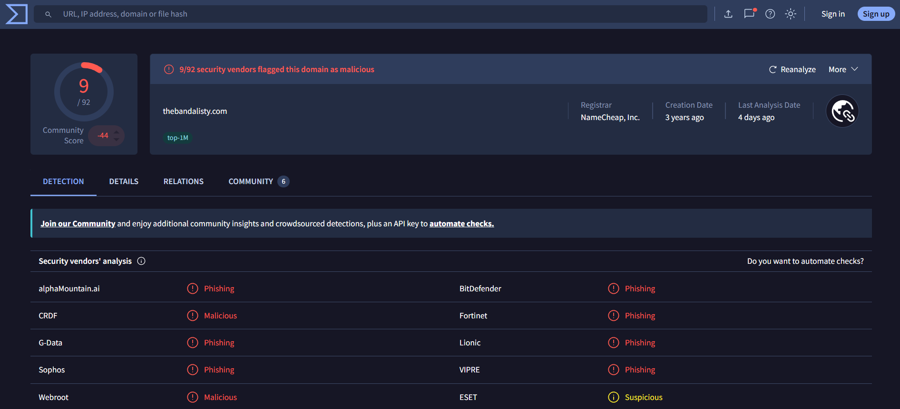
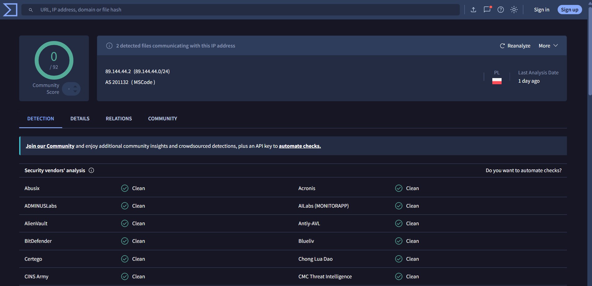
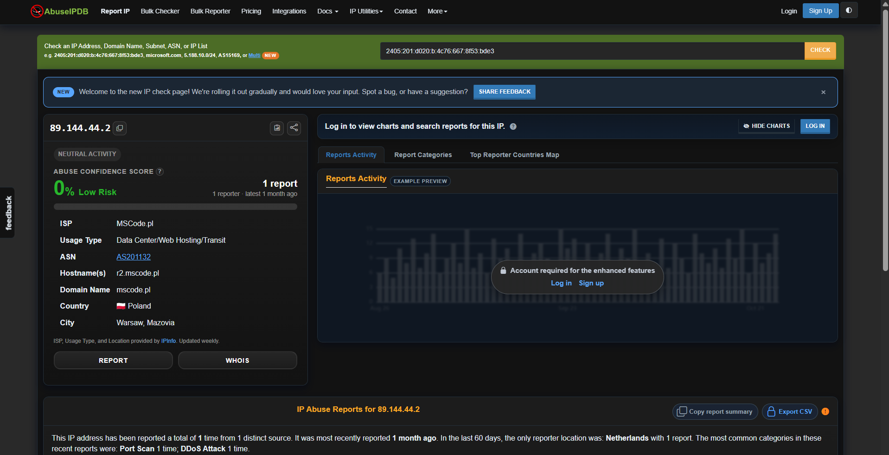

# SOC Phishing Email Investigation

## Project Overview

Conducted a hands-on phishing email investigation
using a real-world email sample from a public
phishing research repository.

The investigation focused on identifying Microsoft
account impersonation, analysing email headers,
extracting suspicious indicators, and conducting
threat intelligence checks.

## Tools Used

- Visual Studio Code
- VirusTotal
- AbuseIPDB
- Email Header Analysis
- SPF, DKIM and DMARC

## Investigation Summary

**Email Subject:** Microsoft account unusual signin activity

**Threat Type:** Suspected phishing / brand impersonation

### Key Findings

1. Sender impersonated the Microsoft account team
   using an unrelated domain.
2. Reply-To directed responses to a Gmail account.
3. SPF and DKIM returned none; DMARC returned
   a permanent evaluation error.
4. Sender IP 89.144.44.2 had 0/92 detections
   on VirusTotal.
5. AbuseIPDB returned a 0% abuse confidence score.
6. The email contained a hidden tracking pixel
   referencing thebandalisty[.]com.
7. VirusTotal flagged the tracking domain with
   9/92 malicious or phishing detections
   at investigation time.

## Investigation Verdict

**Likely Phishing - Microsoft Account Impersonation**

The sender impersonation, suspicious reply
destination, and flagged tracking domain support
the phishing assessment.

The investigation did not establish successful
credential theft or account compromise.

## Evidence

### 1. Tracking Domain Analysis

### 2. Sender IP Analysis

### 3. AbuseIPDB Reputation Analysis

## Full Investigation Report

[Read CASE-001](reports/CASE-001.md)

## Dataset and Scope

Source: Public phishing research sample from
rf-peixoto/phishing_pot on GitHub.

Original email date: September 8, 2023.

This is an independent educational investigation.
Threat intelligence findings reflect the time
of investigation and not necessarily the
reputation of indicators in September 2023.

No production systems were modified.
The original email is not redistributed here.
